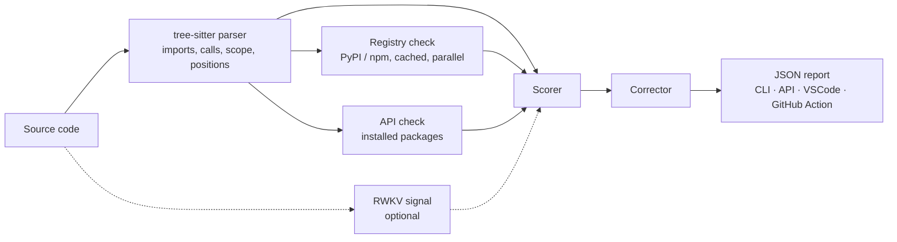

# HalluGuard AI

**Catch the packages and APIs your AI assistant made up — before they reach production.**

[](https://github.com/nadatakouri23/HalluGuard/actions/workflows/ci.yml)


-orange)

LLMs regularly invent imports (`import beautifulsoup`), methods (`requests.fetch_json()`) and
helper functions that look plausible and don't exist. Some invented package names even get
registered by attackers afterwards. HalluGuard checks AI-generated **Python, JavaScript and
TypeScript** against reality: the package registries, the APIs of the packages you actually have
installed, and the scope of the file itself. It runs locally, from the command line, a REST API,
a VSCode extension or a GitHub Action.

## See it work

```python
# examples/demo_hallucination.py
import beautifulsoup
import fake_library_that_does_not_exist

def calculate_analytics():
    data = fetchUserData("http://example.com/api")
    fake_library_that_does_not_exist.do_something()
    return beautifulsoup.BeautifulSoup(data.text, 'html.parser')
```

```console
$ halluguard --format text examples/demo_hallucination.py
examples/demo_hallucination.py:1:7: HIGH unknown_import beautifulsoup - 'beautifulsoup' is a PyPI distribution name, not an importable module; the import name is 'bs4'.
examples/demo_hallucination.py:2:7: HIGH unknown_import fake_library_that_does_not_exist - Package 'fake_library_that_does_not_exist' was not found on the package registry.
examples/demo_hallucination.py:7:11: MEDIUM unknown_function fetchUserData - Function 'fetchUserData()' is not a known builtin, definition or import.
examples/demo_hallucination.py: severity=HIGH risk=65 confidence=HIGH
```

Every finding has a line and a column, a severity, an explanation and (when one exists) a
suggested fix. The default output is JSON, see [Output format](#output-format).

## What it checks

| Finding | How it is established | Severity |
|---|---|---|
| `unknown_import` — the package does not exist, or a PyPI *distribution* name was used as an import (`import pillow`) | PyPI / npm lookup, import→distribution table, project-local modules excluded | HIGH |
| `unknown_attribute` — `requests.fetch_json(...)` | The attribute chain is resolved against the **installed** package, in an isolated subprocess | HIGH (module) / MEDIUM (instance of a class built in the file) |
| `unknown_function` — a bare call that is not a builtin, a definition, an import or an alias | File-level scope analysis | MEDIUM (heuristic) |
| `suspicious_package`, `deprecated_package` | PyPI metadata (single young release, "deprecated" summary) | LOW |

If a check **cannot** be performed (network down, `--offline`, package not installed), HalluGuard
says so under `unverified` instead of guessing. An unreachable registry is never reported as "package
does not exist".

## Quick start

HalluGuard is not on PyPI yet; install it from source (Python 3.11+):

```bash
git clone https://github.com/nadatakouri23/HalluGuard.git
cd HalluGuard
pip install -e .

halluguard --format text path/to/ai_generated.py
```

Optional extras: `pip install -e ".[api]"` (REST server), `".[rwkv]"` (local RWKV signal),
`".[dev]"` (tests and linters).

## How it works



1. **Parse** with tree-sitter (exact positions, aliases, defined names, relative imports).
2. **Verify imports**: standard library → project-local module → known import→distribution
   mapping (`cv2` → `opencv-python`) → installed module → PyPI/npm.
3. **Verify attributes** of real packages against the installed code (`requests.get` yes,
   `requests.fetch_json` no), with "did you mean" suggestions drawn from the real API.
4. **Score**: each issue is worth points; the score saturates smoothly instead of splitting 100
   across imports.
5. **Suggest** fixes (strict fuzzy matching: no suggestion beats a wrong one).

## Usage

### Command line

```bash
halluguard src/app.py web/index.ts              # JSON array on stdout
halluguard --format text src/app.py             # readable, one line per finding
halluguard --offline --fail-on HIGH $(git ls-files '*.py')   # CI gate, no network
halluguard --project-root . src/app.py          # resolve project-local modules
```

`--fail-on {LOW,MEDIUM,HIGH,CRITICAL}` exits with status 1 if a finding of that severity or higher
exists. Use `severity`, not `risk_score`, to gate a build.

### Python

```python
from core.pipeline import analyze

report = analyze(code, language="python")   # python | javascript | typescript (py/js/ts accepted)
print(report.to_dict())
```

Options: `file_name`, `project_root`, `offline`, `check_attributes`, `weights`.

### REST API

```bash
pip install -e ".[api]"
uvicorn api.server:app --host 127.0.0.1 --port 7432
curl -s localhost:7432/analyze -H 'content-type: application/json' \
     -d '{"code": "import not_a_real_pkg", "language": "python"}'
```

`GET /health` reports the RWKV status. CORS is off by default; allow a browser origin with
`HALLUGUARD_CORS_ORIGINS`.

### VSCode extension

Source in [`vscode-extension/`](vscode-extension). Build with `npm ci && npm run compile`
(`npm run package` makes the `.vsix`; build outputs are not committed). Settings: `serverPort`,
`pythonPath`, `modelPath`, `sensitivity` (minimum severity displayed).

### GitHub Action

```yaml
- uses: actions/checkout@v4
- uses: actions/setup-python@v5
  with: { python-version: "3.11" }
- uses: nadatakouri23/HalluGuard/github-action@main
  with:
    severity-threshold: HIGH        # MEDIUM also fails on unresolved calls (heuristic)
    fail-on-hallucination: "true"
```

The action installs HalluGuard itself, comments inline on lines that are part of the diff and
gathers the other findings in a single PR comment. **Not yet run on a real pull request.**

## Output format

```json
{
  "file": "snippet.py",
  "risk_score": 56,
  "risk_level": "HIGH",
  "severity": "HIGH",
  "confidence": "HIGH",
  "hallucinations": [
    {
      "line": 3,
      "column": 7,
      "type": "unknown_import",
      "token": "fake_library",
      "explanation": "Package 'fake_library' was not found on the package registry.",
      "suggestion": "Verify package spelling or find a valid alternative.",
      "severity": "HIGH"
    }
  ],
  "suggestions": [
    {
      "token": "fake_library",
      "original_type": "unknown_import",
      "suggestion": null,
      "explanation": "No close match found for 'fake_library'. Verify the package name manually.",
      "confidence": "LOW"
    }
  ],
  "unverified": [],
  "notes": []
}
```

- `severity` — the worst issue (`NONE` when clean). **Use this to gate CI.**
- `risk_score` / `risk_level` — blended aggregate for ranking and trends (knowledge 0.5, AST 0.3,
  RWKV 0.2, RWKV's weight being redistributed when absent).
- `confidence` — how much of the file could actually be verified, **not** how risky it is.
- `unverified` / `notes` — what could not be checked, and why.

## Offline mode and cache

`--offline` (or `HALLUGUARD_OFFLINE=1`) never touches the network. Only a curated list of popular
packages counts as positive evidence; every other import is `unverified`. Registry answers are
cached in memory and on disk (`~/.cache/halluguard`, override with `HALLUGUARD_CACHE_DIR`), looked
up in parallel, with retry and backoff.

## RWKV signal (optional, experimental)

HalluGuard can add a local [RWKV](https://github.com/BlinkDL/RWKV-LM) language-model signal: the
mean per-token negative log-likelihood of the code, mapped to a `[0, 100]` risk. It is **off unless
you provide a model and a calibration file**, and no code ever leaves your machine (there is no
cloud mode).

```bash
pip install -e ".[rwkv]"
export HALLUGUARD_RWKV_MODEL=models/rwkv-4-1.5b.pth
export HALLUGUARD_RWKV_CALIBRATION=models/rwkv_calibration.json   # {"midpoint": 2.1, "scale": 0.45}
```

This part has only been tested with a stand-in model, and its weight in the score is not yet
justified by data. Treat it as a research feature.

## Status and limitations

HalluGuard is **early-stage**. There is **no benchmark yet**, so precision and recall are unknown,
and the scoring constants are hand-picked. Known limits:

- Attribute checks only work for packages **installed** in the environment running HalluGuard
  (the standard library always works). Install your project's dependencies to get full coverage.
- JavaScript/TypeScript: imports and bare calls only; no attribute verification yet.
- `from package import name` is not yet checked against the package API.
- Scope analysis is per file, not per function; types are inferred only for `var = Class(...)`.
- "Exists on PyPI/npm" is not proof of legitimacy; squatting signals are weak.
- Importing a package to inspect it runs its top-level code (in an isolated subprocess).

Planned next: a labelled benchmark (with a frozen registry snapshot), JS/TS attribute checks, and
calibration of the scorer and the RWKV signal against it.

## Development

```bash
pip install -e ".[dev]"
pytest tests/                       # deterministic: fake registry, no network needed
HALLUGUARD_TEST_NETWORK=1 pytest -m network   # optional live PyPI/npm checks
ruff check . && mypy core cli api
```

```
halluguard/
├── core/        parser · verifier · rwkv_engine · scorer · corrector · pipeline.py
├── cli/  api/   command line · FastAPI server
├── vscode-extension/  github-action/    TypeScript integrations
├── examples/  tests/  benchmarks/       demos · tests (fixtures/) · benchmark (to do)
└── docs/        architecture, analysis and correction reports
```

More detail: [`docs/architecture.md`](docs/architecture.md),
[`docs/RAPPORT_ANALYSE.md`](docs/RAPPORT_ANALYSE.md) (initial audit) and
[`docs/RAPPORT_CORRECTIONS.md`](docs/RAPPORT_CORRECTIONS.md) (what was fixed, with measurements).

## Contributing

Issues and pull requests are welcome; see [CONTRIBUTING.md](CONTRIBUTING.md). Please run the tests
and linters above before opening a PR.

## Credits

HalluGuard grew out of an early prototype by Youssef Maalej (MIT-licensed); the code in this
repository has since been substantially reworked and extended (see
[`docs/RAPPORT_CORRECTIONS.md`](docs/RAPPORT_CORRECTIONS.md)).

## License

[MIT](LICENSE)
