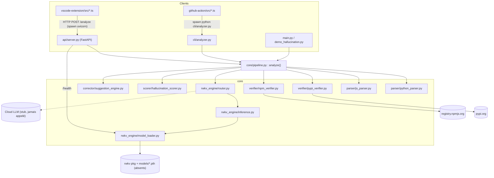
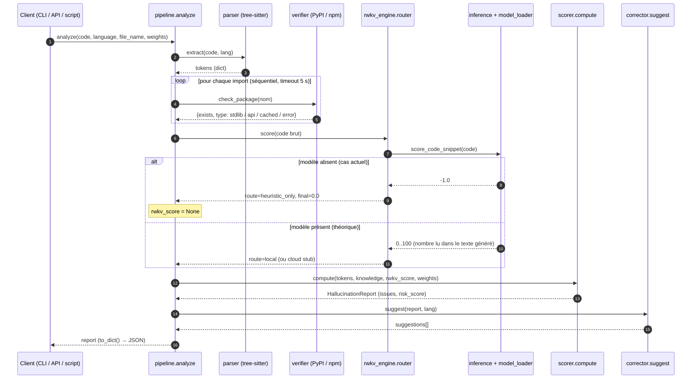

# HalluGuard AI — Rapport d'analyse technique

> **Mise à jour** : les défauts B1 à B24 décrits ci-dessous ont été corrigés depuis cette analyse ; voir [RAPPORT_CORRECTIONS.md](RAPPORT_CORRECTIONS.md). Ce document décrit l'état **avant** corrections (numéros de ligne compris).
>
> Analyse du code réel (commit `7701382`, branche `main`), réalisée sans modification du code source.
> Toutes les affirmations citent `fichier:ligne` (numéros issus de `cat -n` sur l'état actuel du dépôt).
> Les sorties « observées » viennent d'exécutions réelles faites pendant l'analyse (Python 3.13.0, Windows 11, `.venv` du projet).

## 0. Synthèse (à lire en premier)

**Ce qu'est vraiment le projet aujourd'hui** : un détecteur d'« imports inexistants » (existence du nom sur PyPI/npm) et d'« appels de fonctions nues inconnues », assemblé dans un pipeline Python propre et lisible. **RWKV n'est pas fonctionnel dans ce dépôt** : aucun modèle, aucun package `rwkv`/`torch` installé, et le chemin d'inférence n'a jamais été exercé par un test. Le « signal RWKV » est, par conception, un nombre lu dans du texte généré par un modèle de base non évalué.

**Verdict avant benchmark** : ne pas benchmarker en l'état. Les mesures seraient dominées par des artefacts, pas par la qualité de détection. Cinq défauts faussent toute métrique :

| # | Défaut | Effet sur un benchmark |
|---|---|---|
| 1 | Une erreur réseau est traitée comme « package inexistant » | Faux positifs aléatoires, résultats non reproductibles |
| 2 | Décalage octets/caractères dans les parseurs | Tokens corrompus dès qu'il y a un caractère non-ASCII |
| 3 | `line` vaut toujours 0 | Impossible de mesurer une détection au niveau de la ligne |
| 4 | Pas de mapping import → distribution, imports relatifs/locaux mal gérés | Faux positifs massifs sur du code réel |
| 5 | Les méthodes (`requests.fetch_json`) ne sont jamais vérifiées | Le cas d'hallucination le plus courant n'est pas détecté |

**Tests** : 70 collectés, **68 passent, 2 échouent** (timeouts réseau, cf. §4.1). **Benchmark** : le dossier `benchmarks/` ne contient qu'un `.gitkeep` (cf. §5).

**Limites de ma propre analyse** (à connaître) :
- Le réseau était dégradé pendant mes exécutions (lookups PyPI jusqu'à 33 s, timeouts sur `requests`, `numpy`, `axios`, `react`). C'est pénible, mais cela illustre précisément le défaut n°1.
- Le chemin RWKV réel n'a pas pu être exécuté (pas de modèle, pas de package). Ce que j'en dis vient de la lecture du code et d'une simulation avec un faux pipeline (§3.3).
- Je n'ai pas pu reproduire l'installation propre (`pip install -e .` dans un venv vierge a échoué sur un conflit de résolution dû au réseau). Le défaut de dépendances manquantes (§4.3, B9) est établi par lecture, pas par exécution.
- Aucune mesure de couverture (le paquet `coverage` n'est pas installé).
- Les extensions TypeScript (vscode, action) ont été lues, pas exécutées.

---

## 1. ARCHITECTURE

### 1.1 Schéma des modules et dépendances

Dépendances vérifiées sur les `import` réels.



Points à noter, vérifiés dans le code :
- `scorer` et `corrector` ne dépendent d'aucun autre module `core` : le corrector reçoit un `report: Any` (`suggestion_engine.py:64`).
- Le parseur n'alimente **pas** RWKV : `rwkv_router.score(code)` reçoit le code brut (`pipeline.py:79`). Le diagramme de `docs/architecture.md:12` (`B --> D`) est donc inexact.
- VSCode et GitHub Action n'importent rien de Python : ils passent par HTTP (`vscode-extension/src/analyzer.ts:126`) ou par un sous-processus (`github-action/src/analyzer.ts:52`).

### 1.2 Rôle et état de chaque dossier

| Dossier | État | Contenu réel | Preuve |
|---|---|---|---|
| `core/parser/` | **Implémenté, bugs sérieux** | Parseurs tree-sitter Python (188 l.) et JS/TS (147 l.) | §3.1 |
| `core/verifier/` | **Implémenté, fragile** | PyPI (116 l.) et npm (147 l.), cache mémoire 24 h | §3.2 |
| `core/rwkv_engine/` | **Squelette, non fonctionnel** | loader, inférence, routeur. Aucun modèle, `rwkv` non installé, cloud = stub | §3.3 |
| `core/scorer/` | **Implémenté, heuristique non calibrée** | Mélange pondéré 3 sources (194 l.) | §3.4 |
| `core/corrector/` | **Implémenté, très codé en dur** | Dictionnaire de 14 entrées + fuzzy matching | §3.5 |
| `core/pipeline.py` | **Implémenté** | `analyze()` (99 l.) | §2 |
| `api/` | **Implémenté, minimal** | 2 routes (`/analyze`, `/health`), aucun test | `api/server.py:81-95` |
| `cli/` | **Implémenté, minimal** | `cli/analyzer.py` (JSON sur stdout). Pas de `__init__.py`. L'entry point `pyproject` pointe vers un module inexistant | `pyproject.toml:32` |
| `vscode-extension/` | **Partiel** | Source TS complète (~760 l. hors tests), `.vsix` et `out/` committés. Test = placeholder | `src/test/suite/extension.test.ts:6-9` |
| `github-action/` | **Partiel, non exécutable tel quel** | Source TS (270 l.). `dist/index.js` absent (ignoré par git) | `action.yml:24`, `.gitignore` (`dist/`) |
| `benchmarks/` | **Vide** | Un `.gitkeep` de 18 octets | §5 |
| `tests/` | **Partiel** | 70 tests unitaires ; rien sur RWKV, API, CLI, TS | §4.1 |
| `docs/` | Planification | `scope.md`, `architecture.md`, `plan_detaille.md` (545 l.). Plusieurs écarts avec le code (§1.3) | — |
| `models/` | **Absent** | Cité par le README (`README.md:98`), mais ignoré par git (`.gitignore`) | — |

### 1.3 Contradictions entre documentation et code

| # | Document | Dit | Le code fait |
|---|---|---|---|
| D1 | `README.md:54-78` | Exemple de sortie : `risk_score: 42`, **1** hallucination | Même entrée : **36**, **2** hallucinations (§2.3) |
| D2 | `README.md:111`, `docs/scope.md:42`, `LICENSE:1` | Licence MIT | `pyproject.toml:10` : `Apache-2.0` |
| D3 | `docs/architecture.md:34` | RWKV calcule des « sub-token confidence levels » | Génère 256 tokens de texte puis lit un nombre (`inference.py:60-68`). Aucune logprob utilisée |
| D4 | `docs/scope.md` §2.3 | « Token-level confidence scoring », « Streaming validation » | Absents |
| D5 | `docs/architecture.md:34` | Sortie RWKV = « Confidence Float » | `inference.py:37-38` : score = **risque** (0 = fiable). `router.py:8-9` le traite comme une **confiance** (§3.3) |
| D6 | `docs/architecture.md:30` | Vérifie « modules **et méthodes** » | Seuls les noms de packages sont vérifiés (`pypi_verifier.py:114-115`) |
| D7 | `docs/architecture.md:12` | Le parseur alimente RWKV | RWKV reçoit le code brut (`pipeline.py:79`) |
| D8 | `docs/architecture.md:46-53` | Exemple : `line: 12`, `severity: HIGH`, token `fetchUserData()` | `line` toujours 0, sévérité `MEDIUM`, token sans parenthèses |
| D9 | `docs/scope.md:21` | Vérification PyPI, npm **et GitHub** | GitHub non implémenté |
| D10 | `docs/scope.md:101-102,128` | API < 200 ms, RWKV < 100 ms | Cold : 5 969 ms pour 2 imports (§2.3). Génération de 256 tokens sur CPU en < 100 ms : invraisemblable (estimation, non mesurée) |
| D11 | `README.md:92-96` | API/CLI/VSCode/Action « Phase 2/3/4 » | Déjà codés. Seul `benchmarks/` est réellement à faire |
| D12 | `docs/plan_detaille.md:415-416, 430, 335` | `GET /models`, option CLI `--model`, input d'action `rwkv-model` | Aucun des trois n'existe (`server.py`, `cli/analyzer.py:28`, `action.yml:8-20`) |
| D13 | `vscode-extension/package.json:59-79` | Réglages `modelPath`, `sensitivity`, `useCloudFallback` | Jamais lus dans `src/` (`grep` : 0 occurrence) |
| D14 | `README.md:26` | `pip install -r requirements.txt` suffit | `requirements.txt` n'a ni `fastapi` ni `uvicorn` (nécessaires à `api/`) |

---

## 2. PIPELINE

### 2.1 Trace de `analyze()` (`core/pipeline.py:38-99`)

Signature : `analyze(code: str, language="python", file_name=None, weights=None) -> HallucinationReport` (`pipeline.py:38-43`).

| Étape | Lignes | Appel | Entrée | Sortie |
|---|---|---|---|---|
| 0 | 57 | `language.lower()` | `"py"`/`"python"`… | `lang` |
| 1. Parse | 60-70 | `python_parser.extract(code,"python")` ou `js_parser.extract(code,"javascript"\|"typescript")` ; sinon `ValueError` | `code` | `tokens: dict` (clés différentes selon le langage) |
| 2. Vérification | 73-76 | `pypi_verifier.check(tokens)` (Python) ou `npm_verifier.check(tokens)` (JS/TS) | `tokens` | `{"verified_imports": {nom: {package, exists, type, latest_version? \| error?}}}` |
| 3. RWKV | 79-82 | `rwkv_router.score(code)` → `RoutingDecision` ; `rwkv_score = final_score` sauf si `final_score ≤ 0` **et** route = `heuristic_only` | `code` brut | `float \| None` |
| 4. Score | 85 | `compute(tokens, knowledge, rwkv_score, weights)` | tokens + connaissance + RWKV | `HallucinationReport` |
| 5. Corrections | 88-89 | `suggestion_engine.suggest(report, language=lang)` | rapport | `list[dict]` assignée à `report.suggestions` |
| 6. Métadonnées | 92-97 | `report.file = file_name` ou `snippet.<ext>` | — | rapport final |

Structures de données :

- **Tokens Python** (`python_parser.py:180-188`) : `imports` (racines de modules), `from_imports` (`[{module, names}]`), `function_calls` (identifiants nus), `method_calls` (`a.b`), `decorators`, `async_functions`, `classes`.
- **Tokens JS/TS** (`js_parser.py:141-147`) : `imports`, `require_calls`, `function_calls`, `method_calls`, `fetch_calls`. Pas de `from_imports`.
- **Consommation réelle des tokens** : le scorer ne lit que `from_imports` et `function_calls` ; le vérificateur ne lit que `imports` (et `require_calls` pour npm). **`method_calls`, `decorators`, `classes`, `async_functions`, `fetch_calls` ne sont consommés par aucun module** (`grep` dans scorer, corrector, pipeline : 0 occurrence).
- **`RoutingDecision`** (`router.py:36-44`) : `rwkv_score`, `route` (`local|cloud|cloud_fallback|heuristic_only`), `cloud_score`, `final_score`, `latency_ms`, `timestamp`.
- **`HallucinationReport`** (`hallucination_scorer.py:45-77`) : `file`, `risk_score:int`, `confidence:str`, `hallucinations: list[HallucinationIssue]`, `suggestions`, plus `_knowledge_raw/_ast_raw/_rwkv_raw` (debug).
- **`HallucinationIssue`** (`:34-42`) : `line`, `issue_type`, `token`, `explanation`, `suggestion`, `severity`.

### 2.2 Diagramme de séquence



### 2.3 Exécution sur l'exemple du README

Entrée (`README.md:41-46`), `language="python"`, aucun modèle RWKV :

```python
import requests
import fake_library
fake_library.do_magic()
fetchUserData("http://example.com")
```

Sortie **réelle** (`report.to_dict()`), observée :

```json
{
  "file": "snippet.py",
  "risk_score": 36,
  "confidence": "MEDIUM",
  "hallucinations": [
    {"line": 0, "type": "unknown_import", "token": "fake_library",
     "explanation": "Package 'fake_library' was not found on the package registry.",
     "suggestion": "Verify package spelling or find a valid alternative.", "severity": "HIGH"},
    {"line": 0, "type": "unknown_function", "token": "fetchUserData",
     "explanation": "Function 'fetchUserData()' is not a known builtin or imported name.",
     "suggestion": "Check if 'fetchUserData' should be imported or if it exists.", "severity": "MEDIUM"}
  ],
  "suggestions": [
    {"token": "fake_library", "original_type": "unknown_import", "suggestion": null,
     "explanation": "No close match found for 'fake_library'. Verify the package name manually.", "confidence": "LOW"},
    {"token": "fetchUserData", "original_type": "unknown_function", "suggestion": "requests.get(url)",
     "explanation": "Common LLM hallucination; use requests.get().", "confidence": "HIGH"}
  ]
}
```

Scores internes : `_knowledge_raw=50.0`, `_ast_raw=15.0`, `_rwkv_raw=0.0`. Routage journalisé : `route=heuristic_only`, `rwkv_score=-1.0`.

Vérification à la main : 1 import inconnu sur 2 → `100/2 = 50` ; 1 fonction inconnue → `15` ; RWKV absent → poids `knowledge=0.6`, `ast=0.4` ; `50×0.6 + 15×0.4 = 36` ✓.

Écarts avec le README (D1) : le README annonce 42 et une seule hallucination ; il omet `fetchUserData` dans `hallucinations` et `original_type` dans `suggestions`. **`fake_library.do_magic()` n'est pas signalé comme appel** : seul l'import l'est (les `method_calls` sont ignorés).

Temps : **5 969 ms** au premier appel (lookup PyPI de `requests` et `fake_library`), 1 ms ensuite (cache). Résultat dépendant du réseau : lors d'un autre essai, `requests` a expiré (timeout) et a été traité comme inexistant (§4.3, B1).

---

## 3. DÉTAIL PAR MODULE

### 3.1 Parser (`core/parser/`)

**Ce que ça fait.** Parcours récursif de l'arbre tree-sitter (`python_parser.py:83-157`, `js_parser.py:91-137`) avec dédoublonnage en ordre d'insertion. Python : `import X[.Y]` → racine `X` (`:85-93`), `from X import …` (`:96-117`), appels `identifier` vs `attribute` (`:120-126`), décorateurs, classes. JS/TS : `import … from 'm'` (`js_parser.py:93-96`), `require('m')` (`:105-110`), `fetch(...)` (`:113-125`), appels nus et `member_expression`.

**Fonctions clés** : `extract()` dans chaque fichier ; `_node_text()` (`python_parser.py:18-20`, `js_parser.py:19-21`).

**Limites et bugs** (tous reproduits) :

1. **Octets vs caractères** (`python_parser.py:20`, `js_parser.py:21`) : tree-sitter renvoie des offsets **en octets** UTF-8, mais le code découpe une `str` Python (en caractères). Dès qu'un caractère non-ASCII précède un token, les tokens sont décalés. Observé : `# é\nfoo(1)\nbar()` → `['oo(', 'ar(']` (contre `['foo','bar']` sans accent) ; JS : `['o(1', 'r()']` et `"ios.get('"`. Un seul `é` dans un commentaire ou une chaîne suffit à corrompre le reste du fichier. Impact fort sur du code français ou avec des emojis.
2. **Imports relatifs** (`python_parser.py:100`) : le premier `dotted_name` enfant direct est pris pour le module. Dans `from .models import User`, le module est un `relative_import` ; le premier `dotted_name` direct est `User`. Observé : `from . import utils`, `from .models import User`, `from ..core import x` produisent les imports `utils`, `User`, `x`, tous signalés `unknown_import`.
3. **`from z import q as r`** : `names=[]`. Dans la grammaire actuelle, l'`aliased_import` est enfant direct de l'instruction (champ `name`), pas d'un `import_list` (arbre observé : `name: (aliased_import …)`). Conséquence : `r()` est ensuite signalé inconnu.
4. **`async_functions` toujours vide** (`python_parser.py:163-170`, test `prev_sibling == "async"`). Observé : `async def g()` → `[]`. Branche morte (`:141-147` ne fait que `pass`). Non utilisé en aval, donc sans effet sur le score.
5. **Aucune position** : ni ligne ni colonne ne sont enregistrées (cause racine de B3).
6. **Pas de portée** : aucune table des noms définis (fonctions, classes, paramètres, variables, alias).
7. **JS** : `imports` et `require_calls` partagent un même `_seen_imports` (`js_parser.py:65-79`) ; `fetch` est enregistré dans `function_calls` (`:114`) et sera ensuite jugé « inconnu » par le scorer.

**Couverture de test** : 18 tests Python, 12 JS/TS, uniquement en ASCII. Aucun cas d'import relatif, d'alias `from`, de caractère non-ASCII, ni d'`async` réel.

### 3.2 Verifier (`core/verifier/`)

**Ce que ça fait.** Pour chaque import : stdlib → valide (`pypi_verifier.py:68-70`, via `sys.stdlib_module_names` de l'interpréteur courant, `:38-45`) ; cache TTL 24 h en mémoire (`:73-80`) ; sinon `GET https://pypi.org/pypi/{nom}/json`, `timeout=5`, `exists = (status == 200)` (`:83-90`). npm : même logique sur `https://registry.npmjs.org/{pkg}` (`npm_verifier.py:107-117`), avec extraction du nom de package (scopes, sous-chemins, `:54-68`), détection des chemins locaux (`:87-89`) et des built-ins Node (`:37-51`).

**Limites** :

1. **Erreur réseau = « n'existe pas »** (`pypi_verifier.py:96-97`, `npm_verifier.py:119-120` : `exists=False, type="error"`). Le scorer ne regarde que `exists` (`hallucination_scorer.py:116`) et signale `unknown_import` HIGH. Observé : `requests`, `numpy`, `PIL`, `dateutil`, `axios`, `react` signalés à tort sur timeout. C'est la cause des 2 tests en échec.
2. **Nom d'import ≠ nom de distribution** : la requête utilise le nom d'import tel quel (`:83`). Observé : `cv2` → 404, `yaml` → 404, `dateutil` → non résolu → signalés « n'existent pas » alors que ce sont des imports valides.
3. **Faux négatifs par squatting** : « existe sur PyPI » ne prouve rien. Observé comme existants : `sklearn` (0.0.post12, stub), `bs4`, `beautifulsoup` (3.2.2), `attr`. Un nom halluciné puis enregistré par un tiers passe.
4. **Imports locaux** : un module du projet (`mymodule_local`) est interrogé sur PyPI, donc signalé.
5. **Performance** : séquentiel, 5 s par import non caché (`:85`), cache non persistant (donc inutile pour la CLI et la GitHub Action qui lancent un processus par exécution). Observé : jusqu'à 33 s pour un seul lookup `pandas` sur réseau dégradé. Les tests durent 50 s.
6. **Built-ins Node incomplets** (`npm_verifier.py:37-44`) : manquent notamment `async_hooks`, `inspector`, `diagnostics_channel`, `trace_events`. Les imports de sous-chemins (`#interne`) partent sur npm.
7. Aucun contrôle de version malgré la docstring (« Version validation when available », `pypi_verifier.py:8`) : la version est lue mais jamais utilisée.

**Tests** : 10 (PyPI) + 9 (npm), dont plusieurs avec **appels réseau en direct** (`test_pypi_verifier.py:34-37`, `test_npm_verifier.py:51-58`), donc non déterministes.

### 3.3 RWKV (`core/rwkv_engine/`) — module prioritaire

#### Quel modèle ?
- Chemin par défaut `models/rwkv-4-1.5b.pth` (`model_loader.py:29`), surchargeable par `HALLUGUARD_RWKV_MODEL` (`:18`). Tokenizer `20B_tokenizer.json` (`:34`, env `HALLUGUARD_RWKV_TOKENIZER`). Stratégie `"cpu fp32"` (`:42`). `scope.md:20` mentionne aussi un modèle 3B.
- Chargement paresseux via `from rwkv.model import RWKV` / `from rwkv.utils import PIPELINE` (`:72-77`).
- **État réel : inopérant.** Dans le `.venv`, ni `rwkv` ni `torch` ne sont installés, `models/` n'existe pas. Le message observé au démarrage : `RWKV model not found at 'models\rwkv-4-1.5b.pth'. RWKV scoring will be disabled`. Le paquet `rwkv` n'est déclaré ni dans `pyproject.toml:13-20` ni dans `requirements.txt`.
- Il s'agit d'un modèle **de base** (RWKV-4), pas d'un modèle instruct, et aucune évaluation ne justifie qu'il sache juger des API.

#### Quel prompt ?
`inference.py:20-25` :
```
Analyze this code snippet for potential hallucinations.
For each function call or API usage, rate its validity (0-100).
Code:
{code}
Output JSON only.
```
Zero-shot, sans exemple, sans schéma JSON, dans une seule langue pour Python et JS/TS. Le prompt demande une note **par appel** (« validity »), alors que le code attend **un seul nombre** (§ suivant).

#### Quel signal en sort ?
- **Du texte généré**, pas des logprobs : `pipeline.generate(prompt, token_count=256, args=...)` (`inference.py:60-64`), avec `temperature=0.2, top_p=0.1, alpha_frequency=0.25, alpha_presence=0.25` (`:78-86`). Échantillonnage non déterministe (température > 0), pas de graine.
- `_parse_score` (`:88-121`) : 1) `json.loads` ; si dict, première clé parmi `risk_score`, `score`, `hallucination_score`, `validity` (inversée : `100 − val`), bornée à [0,100] ; 2) sinon **premier token numérique** dans [0,100] ; 3) sinon **50.0 par défaut** (`:120`).
- Comportements observés sur des sorties plausibles :

| Sortie brute | Score extrait |
|---|---|
| `{"risk_score": 80}` | 80.0 |
| `{"validity": 90}` | 10.0 |
| `{"requests.get": 95, "foo": 10}` | 95.0 (premier nombre, sans rapport avec un risque) |
| `Python 3.11 is used` | **3.11** |
| `1. The code uses requests.get` | **1.0** (numéro de liste) |
| `[{"call":"foo","validity":0}]` (forme demandée par le prompt) | **50.0** (liste non gérée) |
| `No hallucination detected` ou chaîne vide | **50.0** |
| `150` | 100.0 |

Conclusion : le signal est, en pratique, du bruit borné. Pour tout texte non conforme, il vaut 50, ce qui ajoute `50 × 0.2 = +10` points de risque à n'importe quel code.

#### Comment il entre dans le score
- Pipeline : `rwkv_score = routing.final_score` (`pipeline.py:81-82`).
- Scorer : si `rwkv_score ≥ 0`, il est mélangé avec le poids 0,20 (`hallucination_scorer.py:166-167,176-180`). Simulation (faux pipeline) : sortie `{"risk_score": 80}` → +16 points sur un code propre (risk 16) ; sortie « garbage » → +10 ; sortie `{"risk_score": 20}` → 4.
- Il n'y a aucune corrélation établie entre ce nombre et l'existence d'une hallucination : pas de dataset, pas d'évaluation.

#### Que se passe-t-il s'il est absent (fallback) ?
- `get_pipeline()` renvoie `None` → `score_code_snippet` renvoie le sentinelle **`-1.0`** (`inference.py:49-53`) ; toute exception d'inférence donne aussi `-1.0` (`:69-71`).
- Le routeur répond `route="heuristic_only", final_score=0.0` (`router.py:102-107`). Le pipeline voit `final_score == 0` et `route == heuristic_only` → `rwkv_score=None` (`pipeline.py:81`).
- Le scorer **redistribue** le poids RWKV à parts égales : `knowledge 0.5→0.6`, `ast 0.3→0.4` (`hallucination_scorer.py:169-173`). Correct (vérifié : 50×0,6 + 15×0,4 = 36).
- Le loader marque l'échec comme « tenté » (`model_loader.py:68,86,90` : `_loaded = True`) et ne réessaie jamais sans `reset()`.

#### Routage local / cloud (`router.py`)
Logique (`:86-131`), `_LOCAL_THRESHOLD = 60` (`:28`) :

| Cas | Route | `final_score` |
|---|---|---|
| RWKV indisponible, pas de clé cloud | `heuristic_only` | 0.0 |
| RWKV indisponible, clé cloud | `cloud_fallback` | cloud si ≥ 0, sinon **0.0** |
| RWKV ≥ 60 | `local` | RWKV |
| RWKV < 60, clé cloud | `cloud` | cloud si ≥ 0, sinon RWKV |
| RWKV < 60, pas de clé | `local` | RWKV |

Problèmes :
1. **`_call_cloud_llm` est un stub qui renvoie toujours `-1.0`** (`:52-71`), malgré une URL par défaut OpenAI (`:61`). Le « cloud » n'existe pas.
2. **Sémantique inversée** : l'inférence définit `0 = fiable, 100 = risque max` (`inference.py:37-38`). Le routeur lit le score comme une **confiance** : « ≥ 60 : la réponse locale est assez confiante » (`router.py:8-9`). Résultat : un code jugé **très risqué** (score 80) est considéré comme « sûr, pas de second avis », et un code jugé **sain** (score 20) est envoyé au cloud. Le seuil 60 n'a pas de justification documentée.
3. **Effet de bord du `cloud_fallback`** : avec une clé définie mais le stub, `final_score = 0.0` et `route = cloud_fallback`. Le pipeline teste `route != "heuristic_only"` (`pipeline.py:81`), donc passe `rwkv_score=0.0` comme un vrai signal. Le poids 0,20 reste actif sans redistribution, et **le risque est mécaniquement dévalué**. Observé : `fooo()` → 6 sans clé, 4 avec clé.
4. `_routing_log` croît sans limite en mémoire (`:33,136`), ce qui pose un problème pour un serveur API de longue durée.
5. Confidentialité : `scope.md:63` promet « code never leaves the machine » ; une fois le stub implémenté, le code partira vers une API externe par défaut. À encadrer explicitement.

#### Autres limites RWKV
- `is_available()` (`model_loader.py:37-39`) vérifie seulement l'existence du fichier ; `/health` (`server.py:93`) peut donc répondre `rwkv_available: true` alors que le package `rwkv` manque.
- RWKV est appelé **à chaque analyse**, sans condition, y compris pour du code sans aucun candidat suspect (`pipeline.py:79`).
- Tests : **aucun** pour `inference`, `model_loader`, `router`.

### 3.4 Scorer (`core/scorer/hallucination_scorer.py`)

**Poids exacts** (`:27-31`) : `knowledge=0.50`, `ast=0.30`, `rwkv=0.20`. Si RWKV est absent : `knowledge=0.60`, `ast=0.40` (`:169-173`).

**Formule** :
```
knowledge_score = min(100, Σ 100/N_imports  pour chaque import dont exists=False)      (:113-127)
ast_score       = min(100, 15 × nb de fonctions nues hors builtins/from-imports)       (:149-161)
rwkv_effective  = rwkv_score (si ≥ 0) sinon 0                                          (:164-173)
raw             = k·w_k + a·w_a + r·w_r                                                (:176-180)
risk_score      = int(max(0, min(100, round(raw))))                                    (:181)
```

**Seuils de sévérité** (`:18-23`) : LOW 1-25, MEDIUM 26-50, HIGH 51-75, CRITICAL 76-100.

**Constats :**
1. **Les seuils ne servent à rien.** `severity = _severity_label(risk_score)` est calculé (`:183`) puis **jamais stocké ni retourné** : `HallucinationReport(...)` (`:186-193`) n'a pas de champ de sévérité globale. Observé : `_severity_label(0)` → `LOW` alors que la plage commence à 1 (`:85`).
2. **La sévérité par issue est codée en dur** : `unknown_import` → `HIGH` (`:124`), `unknown_function` → `MEDIUM` (`:158`). Il n'existe jamais de `LOW` ni de `CRITICAL` dans les issues. Or l'action GitHub filtre sur ces niveaux (`github-action/src/reporter.ts:90-100`), avec seuil par défaut `MEDIUM` (`action.yml:16`) : **toute fonction locale non reconnue fait échouer la PR** (§4.3, B7).
3. **`confidence`** (`:184`) : `HIGH` si `risk ≥ 70` ou `risk == 0`, sinon `MEDIUM`. Ce n'est pas une confiance (jamais `LOW`) : c'est une fonction du risque, sans lien avec la qualité du signal.
4. **Poids non justifiés** : aucun dataset, aucune calibration, aucune ablation. `docs/plan_detaille.md` ne propose que des cibles (`:471-472`, chiffres illustratifs).
5. **Saturation** : 7 fonctions inconnues suffisent à atteindre `ast_score = 100` (observé : 8 appels → 100). Une grande base de code produit mécaniquement un score maximal.
6. **Normalisation du score « knowledge »** : `100/N` par import manquant. Un fichier avec 1 import non résolu sur 1 donne 100 → `risk=60` (HIGH) ; le même import dans un fichier de 20 imports donne `5`. Un seul import halluciné est dilué selon le nombre d'imports valides, ce qui est trompeur.
7. **Un risque de 36** (README) classé `MEDIUM` mais contenant un import HIGH : la sévérité globale et celle des issues se contredisent.
8. **Détection de fonctions inconnues** : liste de 52 builtins (`:138-146`) incomplète (observé faux positifs : `bytes`, `bytearray`, `callable`, `format`, `ord`, `chr`, `divmod`, `pow`, `frozenset`, `object`, `Exception`, `ValueError`, `slice`, `complex`, `bin`, `hex`, `__import__` : **17 faux positifs sur 20 builtins testés**). Les fonctions et classes définies dans le fichier sont signalées (observé : `helper()`, `A()`). Les alias (`OD`) sont signalés. Cette liste de builtins Python est aussi appliquée aux fichiers JS/TS (`fetch`, `foo` signalés).
9. `line=0` codé en dur (`:119,153`) (B3).
10. Validation des poids absente : des poids qui ne somment pas à 1 ne sont pas normalisés (`:107`).

**Tests** : 7 tests, aucun ne valide le comportement sur du code réel.

### 3.5 Corrector (`core/corrector/suggestion_engine.py`)

**Ce que ça fait.** Pour chaque issue : 1) correspondance exacte dans `COMMON_PATTERNS` (`:20-38`, 14 entrées) → confiance HIGH (`:87-93`) ; 2) pour un import : fuzzy matching `difflib` (cutoff 0,5) sur 30 packages PyPI (`:41-48`) ou 22 packages npm (`:50-55`) (`:96-111`) → MEDIUM/LOW ; 3) pour une fonction : fuzzy matching **sur les clés de `COMMON_PATTERNS`** (`:115`) ; 4) sinon « No automatic suggestion ».

**Patterns codés en dur** :
- Mélange de natures différentes dans un seul dictionnaire : alias d'import (`sklearn`, `cv2`, `yaml`, `PIL`, `dotenv`, `:24-28`), noms de fonctions hallucinées (`fetchUserData`, `getData`, `sendRequest`, `connectDB`, `fetchFromAPI`, `:30-34`) et paquets npm déjà valides (`node-fetch`, `axios`, `:36-37`, dont la « suggestion » est le même nom).
- Ces patterns **ne se déclenchent que si l'issue a déjà été levée**. Or `sklearn` et `beautifulsoup` **existent sur PyPI** (observé), donc ne sont jamais signalés ; leurs entrées sont de fait inatteignables. À l'inverse `cv2`/`yaml` sont signalés par le verifier, et la bonne suggestion n'arrive qu'après coup.
- Les noms de fonctions codés en dur suggèrent `requests.get(url)` quel que soit le contexte (JS inclus, où `requests` n'existe pas).

**Bugs observés** :
- Fuzzy matching absurde sur les fonctions : `object()` → `sqlalchemy.create_engine(url)` (ressemble à `connectDB`), `slice()` → `scikit-learn` (`:115-120`). Le cutoff 0,5 est trop permissif et l'espace de recherche n'a aucun rapport sémantique.
- Fuzzy matching sur les imports : `dateutil` → `pydantic`, `utils` → `beautifulsoup4`, et même `numpy` (signalé à cause d'un timeout) → « Did you mean 'numpy'? 'numpy' is not a known package. » (`:99-103`).
- `suggest(..., language=lang)` reçoit `lang` brut (`pipeline.py:88`) mais teste `language == "python"` (`suggestion_engine.py:77`) : avec `language="py"` (alias accepté par `pipeline.py:33`), les candidats **npm** sont utilisés pour du code Python.
- Pas de suggestion pour les méthodes hallucinées (non détectées en amont).

**Tests** : 5 tests ; rien sur les cas ci-dessus.

---

## 4. QUALITÉ ET BUGS

### 4.1 Tests (exécutés)

Commande : `PYTEST_DISABLE_PLUGIN_AUTOLOAD=1 python -m pytest tests/ -v`, Python 3.13.0, pytest 9.1.1.

```
70 collected — 68 passed, 2 failed — 50.82 s
FAILED tests/test_npm_verifier.py::TestBatchCheck::test_batch_check    (assert vi["axios"]["exists"] is True)
FAILED tests/test_pypi_verifier.py::TestCheckPackage::test_real_package (assert result["exists"] is True)
```
Cause des deux échecs : **timeouts réseau** (`Read timed out (read timeout=5)`, observé), puis conversion en `exists=False` (B1). Juste après, `pypi.org` répondait 200. Les tests sont donc **non déterministes** : ils dépendent d'Internet.

Répartition : corrector 5, js_parser 12, npm_verifier 9, pipeline 9, pypi_verifier 10, python_parser 18, scorer 7.

| Module | Tests | Appréciation |
|---|---|---|
| python_parser, js_parser | 30 | Cas ASCII simples uniquement ; aucun cas qui échoue (octets, relatifs, alias, async) |
| verifier | 19 | Réseau en direct, aucun mock ; aucun test d'erreur réseau |
| scorer | 7 | Valeurs simples ; pas de cas de saturation/dilution |
| corrector | 5 | Cas heureux |
| pipeline | 9 | Appels réseau ; aucun test de bout en bout avec un oracle |
| **rwkv_engine** (loader, inférence, routeur) | **0** | Aucune couverture ; `_parse_score` jamais testé |
| **api/** | **0** | |
| **cli/** | **0** | |
| **vscode / github-action** | placeholder | `extension.test.ts` ne teste rien d'utile (`assert.strictEqual(-1, [1,2,3].indexOf(5))`) |

Qualité statique (outils du `.venv`) :
- `ruff check . --exclude .venv` : **34 erreurs** (24 corrigeables automatiquement), alors que le commit `21c654d` indique avoir corrigé Ruff. CI (`ci.yml:26-27`) échouerait sur cette étape.
- `mypy core` : **5 erreurs** (`python_parser.py:143,151`, `model_loader.py:72-73`, `inference.py:77`) alors que `pyproject.toml:42-44` impose `strict = true` ; `ci.yml:29-30` échouerait.

### 4.2 Vérifications demandées, résultats

| Vérification | Résultat | Détail |
|---|---|---|
| **Numéros de ligne** | **Toujours `0`** | `hallucination_scorer.py:119,153`. Les parseurs ne gardent aucune position. Le reporter GitHub force `Math.max(line,1)` (`reporter.ts:46`) : **tous les commentaires atterrissent en ligne 1**. L'extension VSCode retrouve le token par recherche textuelle avec repli ligne 0 (`decorations.ts:107-128`) |
| **Mapping import → package** | **Absent** | `cv2`, `yaml`, `dateutil` : signalés. `PIL` : non concluant (timeout). `sklearn`, `bs4` : passent par hasard (projets stub sur PyPI). Le mapping n'existe que dans `COMMON_PATTERNS` (`suggestion_engine.py:24-28`), en aval |
| **Imports locaux et relatifs** | **Faux positifs** | `from .models import User` → import `User` ; `from . import utils` → `utils` ; `import mymodule_local` interrogé sur PyPI |
| **Méthodes hallucinées sur vrai package** | **Non détectées** | `requests.fetch_json(...)`, `requests.get_all(...)` → `risk_score: 0`, `hallucinations: []`. `method_calls` n'est lu nulle part |
| **Dépendance réseau PyPI/npm** | **Critique** | Timeout 5 s, séquentiel, erreur = « inexistant », cache non persistant, aucun mode hors ligne |
| **Patterns codés en dur (corrector)** | **Oui** | Dictionnaire de 14 entrées + 2 listes de 30/22 packages (`suggestion_engine.py:20-55`) ; fuzzy matching absurde observé |

### 4.3 Liste des bugs et faiblesses, par gravité

**Légende** : 🔴 critique (fausse les résultats) · 🟠 majeur · 🟡 modéré · ⚪ mineur.

#### 🔴 Critiques

**B1 — Erreur réseau interprétée comme « package inexistant »**
`pypi_verifier.py:96-97`, `npm_verifier.py:119-120`, lu par `hallucination_scorer.py:116`.
Effet : faux positifs HIGH aléatoires (observé sur `requests`, `numpy`, `axios`, `react`), 2 tests rouges, résultats non reproductibles.
Correction : état ternaire `exists: True | False | None`. En cas d'erreur, `exists=None`, `type="unverified"`, **aucune issue levée** (ou issue `LOW` « non vérifié »), et exclusion du dénominateur `total_imports`. Ajouter retry avec backoff, `requests.Session` avec pool, vérifications en parallèle (`ThreadPoolExecutor`) et cache disque. Distinguer 404 (inexistant) des 5xx/429 (indéterminé).

**B2 — Décalage octets/caractères dans les parseurs**
`python_parser.py:20`, `js_parser.py:21`.
Effet : tokens corrompus (`'oo('`) dès qu'un caractère non-ASCII précède ; le reste du fichier est faux.
Correction : conserver `src = code.encode("utf8")` et utiliser `src[node.start_byte:node.end_byte].decode("utf8")` (ou `node.text.decode()`). Ajouter un test avec `é`, emoji et CJK.

**B3 — `line` vaut toujours 0**
`hallucination_scorer.py:119,153` ; aucune position dans les parseurs.
Effet : GitHub Action commente la ligne 1 (`reporter.ts:46`), VSCode doit deviner, benchmark par ligne impossible.
Correction : chaque parseur renvoie des objets `{name, line, col}` (`node.start_point` + 1) au lieu de chaînes ; le scorer propage la ligne. Garder la rétrocompatibilité via un champ `*_positions`.

**B4 — Pas de mapping import → distribution**
`pypi_verifier.py:83` ; `cv2`, `yaml`, `dateutil` signalés ; `sklearn`/`bs4` passent par accident.
Correction : table import→distribution (extraite de `importlib.metadata.packages_distributions()` pour l'environnement + table statique `{"cv2":"opencv-python","yaml":"pyyaml","PIL":"pillow","sklearn":"scikit-learn","bs4":"beautifulsoup4","dateutil":"python-dateutil",…}` ), interrogation PyPI par **nom de distribution**. Ne pas se fier à l'existence d'un nom sur PyPI pour `sklearn` (stub dépréciée) : traiter les stubs connus explicitement.

**B5 — Imports relatifs et locaux mal gérés**
`python_parser.py:96-117`.
Correction : détecter le nœud `relative_import` et l'ignorer pour la vérification (module local) ; extraire les noms depuis le champ `name` (multiples) ; résoudre les modules locaux en cherchant `<racine>/<nom>.py` ou `<nom>/__init__.py` (option `project_root`).

**B6 — Les méthodes d'API ne sont jamais vérifiées**
`method_calls` extrait mais jamais consommé. `requests.fetch_json` → score 0.
C'est le cas d'hallucination le plus fréquent et la promesse du produit (`architecture.md:30`).
Correction : résoudre l'alias (`import requests as r`), puis vérifier `module.attribut` contre l'API réelle : introspection dans un sous-processus isolé du package installé (`hasattr` récursif), ou index des symboles publics (stubs `typeshed`, `__all__`). Émettre `unknown_attribute` avec ligne.

#### 🟠 Majeurs

**B7 — Faux positifs « fonction inconnue »**
`hallucination_scorer.py:138-161`. 17/19 builtins faux positifs ; fonctions/classes locales et alias signalés ; liste Python appliquée à JS/TS ; `fetch`, `console` ignorés ou mal classés.
Correction : construire l'ensemble des noms connus avec `dir(builtins)` + `def`/`class`/paramètres/affectations/alias du fichier (analyse de portée) ; pour JS, une table de globals JS/Node/navigateur et les `import {x}` locaux. Ne signaler que les noms vraiment non résolus.

**B8 — Packaging et CI cassés**
`pyproject.toml:13-20` n'inclut ni `tree-sitter-javascript` ni `tree-sitter-typescript` alors que `core/pipeline.py:24` importe `js_parser` (qui les importe, `js_parser.py:9-10`) ; `pyproject.toml:32` pointe vers `cli.haluguard:main` (le fichier s'appelle `cli/analyzer.py`, sans `main` exposé au niveau paquet, et `cli/` n'a pas de `__init__.py`) ; `rwkv`/`torch` non déclarés ; `requirements.txt` sans `fastapi`/`uvicorn`. `ci.yml:24` installe via `pip install -e ".[dev]"` : par lecture, `import core.pipeline` échoue sur un environnement propre (non reproduit, cf. §0).
Ruff (34) et mypy strict (5) échouent aussi.
Correction : déclarer toutes les dépendances (extra `rwkv`, `api`), corriger l'entry point (`halluguard = "cli.analyzer:main"`), ajouter `cli/__init__.py`, aligner `requirements.txt` sur `pyproject`, corriger Ruff/mypy, et épingler Python 3.11 **et** 3.13 en CI.

**B9 — Signal RWKV sans valeur démontrée, mal défini**
`inference.py:20-25,88-121`.
Prompt zero-shot sur modèle de base ; génération échantillonnée ; extraction de nombre fragile (3.11, numéro de liste, 50 par défaut) ; aucun test.
Correction : (a) utiliser un **signal calibré** plutôt que du texte : log-vraisemblance moyenne / perplexité des tokens d'appel d'API sous le modèle (accessible via les logits de `rwkv`), ou un score du premier token de `"yes"/"no"` ; (b) `temperature=0`, sortie contrainte ; (c) accepter les listes JSON ; (d) renvoyer `None` plutôt que 50 sur échec ; (e) valider par ablation (§5) avant de lui donner un poids ; sinon poids 0.

**B10 — Routage RWKV/cloud incohérent**
`router.py:8-9,91-131`, `pipeline.py:81-82`. Sémantique risque/confiance inversée ; `cloud_fallback` renvoie 0.0 interprété comme score valide ; stub cloud.
Correction : définir un seul sens (risque), router sur l'**incertitude** (|score − 50| faible) plutôt que sur le niveau ; propager `None` quand aucun score valide n'existe (`route in {"heuristic_only","cloud_fallback"} and cloud_score<0`) ; documenter ou retirer le cloud tant qu'il est un stub.

**B11 — GitHub Action inutilisable en l'état**
`action.yml:24` : `dist/index.js` absent (`dist/` ignoré par git) ; `github-action/src/analyzer.ts:30` exige `cli/analyzer.py` **dans le workspace de l'utilisateur** (n'existe que dans ce dépôt) ; dépendances Python à installer par l'appelant ; commentaires tous en ligne 1 (B3) ; seuil `MEDIUM` par défaut combiné à B7 : échec de PR sur des fonctions locales.
Correction : empaqueter (`ncc build` → `dist/` committé ou release), installer HalluGuard depuis PyPI (`pip install halluguard-ai`) dans l'action, mapper les lignes sur les hunks du diff, ne faire échouer que sur `HIGH+` tant que B7 n'est pas corrigé.

**B12 — Dépendance réseau et performance**
`pypi_verifier.py:85`, `npm_verifier.py:109`. Séquentiel, 5 s/import, cache non persistant.
Correction : parallélisme, cache disque (`~/.cache/halluguard`), mode `--offline` (index local de noms de packages), préchargement de la liste simple PyPI (`/simple/`) et de snapshots npm pour benchmarks.

#### 🟡 Modérés

**B13 — Sévérité globale et `confidence` sans signification** — `hallucination_scorer.py:183-184`.
Correction : stocker `report.severity = _severity_label(risk_score)` (corriger `0 → "NONE"`), renommer ou supprimer `confidence`, ou le calculer à partir de l'accord entre sources (AST, connaissance, RWKV).

**B14 — Scorer : dilution et saturation** — `:117,151,161`. 1 import halluciné pèse 100/N ; 7 fonctions suffisent à saturer.
Correction : score additif par issue avec poids par type (import inconnu > attribut inconnu > fonction inconnue), puis fonction concave (`1 − e^(−x)`) ; ne pas diviser par le nombre d'imports valides.

**B15 — Corrector : fuzzy matching incohérent et patterns inatteignables** — `suggestion_engine.py:20-55,77,115`.
Correction : fuzzy matching restreint à des candidats sémantiquement pertinents (même package) avec cutoff ≥ 0,8 ; supprimer les entrées non-hallucinations (`axios`, `node-fetch`) ; corriger `language == "python"` (normaliser les alias) ; séparer `ALIASES` (import → distribution) de `HALLUCINATED_NAMES`.

**B16 — API : bloquante et peu robuste** — `server.py:82` (`async def` appelant du code bloquant : réseau + RWKV bloquent la boucle) ; `ValueError` pour une langue inconnue → HTTP 500 ; `allow_origins=["*"]` (`:34`) : n'importe quelle page web du poste peut poster du code à `127.0.0.1:7432`.
Correction : `def` (threadpool) ou `run_in_threadpool`, `HTTPException(400)`, restreindre CORS à l'origine `vscode-webview`, ou le supprimer si inutile.

**B17 — Faux sentiment de vérification par existence de nom** (squatting / stubs). Correction : signaux complémentaires (date de création, nombre de releases, présence dans une liste d'allow, avertissement pour les packages très récents ou à 1 release).

#### ⚪ Mineurs

- **B18** — `async_functions` toujours vide (`python_parser.py:163-170`).
- **B19** — `_routing_log` non borné (`router.py:33,136`).
- **B20** — `/health` : `rwkv_available` ne vérifie pas le package (`model_loader.py:37-39`).
- **B21** — Réglages VSCode `modelPath`, `sensitivity`, `useCloudFallback` jamais lus (`package.json:59-79`).
- **B22** — Licence incohérente MIT/Apache (D2) ; docs et README divergents (§1.3).
- **B23** — Hygiène du dépôt : `.vsix` et `out/` committés ; `tests/hallucinated_code.py`, `test_snippet.py`, `halluguard_ai.egg-info/` non suivis ; deux démos redondantes (`main.py`, `demo_hallucination.py`).
- **B24** — Built-ins Node incomplets (`npm_verifier.py:37-44`) ; stdlib évaluée selon l'interpréteur d'exécution et non la version cible du code analysé ; fallback `< 3.10` mort (`pypi_verifier.py:42-43`, `requires-python >=3.11`).

### 4.4 Ordre de correction recommandé avant benchmark

1. **B1** (fiabilité), **B2** (parseur), **B3** (positions) : sans eux, aucune mesure n'est valide.
2. **B4, B5, B7** : réduire les faux positifs sur du vrai code.
3. **B6** : ajouter la détection de méthodes hallucinées, ce qui est le cœur de la valeur du produit.
4. **B8** : rendre le dépôt installable et la CI verte.
5. **B9, B10** : seulement ensuite, rendre RWKV mesurable (avec une vraie ablation).
6. Le reste (B11-B24) : intégrations et finitions.

---

## 5. ÉTAT DU BENCHMARK

### 5.1 Ce que contient `benchmarks/`
**Rien d'exploitable.** Un seul fichier : `benchmarks/.gitkeep` (18 octets). Aucun dataset, aucun runner, aucun résultat. `README.md:96` le classe « Phase 5 ».

Ce qui existe autour :
- `docs/plan_detaille.md:231` : intention de « 50 exemples annotés manuellement » ; `:452` : stockage prévu dans `benchmarks/dataset/` ; `:471-472` : tableau de **résultats fictifs** (« RWKV 1.5B 71 % / 3B 78 % »). Ce ne sont pas des mesures.
- `docs/scope.md:126-128` : objectifs de succès (> 80 % de précision, < 10 % de faux positifs, < 100 ms) **sans protocole de mesure**.
- `router.py:32-33,136-143` : un journal de routage en mémoire « pour les benchmarks », jamais exporté.
- `tests/hallucinated_code.py` et `test_snippet.py` (non suivis) : deux exemples isolés, sans étiquettes.

### 5.2 Ce qui manque pour un benchmark reproductible

| Manque | Pourquoi c'est bloquant | Proposition |
|---|---|---|
| **Dataset étiqueté** | Pas de vérité terrain | Fichiers JSONL : `{id, language, code, labels:[{line, type, token}], source}`. Types : `unknown_import`, `unknown_attribute`, `unknown_function`, `wrong_signature`, `clean`. Inclure autant d'exemples **propres** (vrais imports `cv2/yaml/PIL`, imports relatifs, code non-ASCII) que d'exemples hallucinés pour mesurer les faux positifs |
| **Taille et provenance** | 50 exemples ne permettent pas un intervalle de confiance utile | ≥ 300 exemples, à la fois synthétiques (injection contrôlée d'erreurs dans du code réel) et issus de sorties de LLM réelles ; documenter modèle, prompt, date |
| **Protocole de scoring** | Pas de définition d'un « hit » | Correspondance (fichier, ligne ±0, type, token) ; métriques par type : précision, rappel, F1, taux de faux positifs sur code propre ; AUROC pour `risk_score` |
| **Déterminisme du réseau** | Les verifiers appellent PyPI/npm en direct (B1) | Snapshot figé du registre (liste de noms + métadonnées minimales) et mode `--offline`/injection de dépendance dans les verifiers ; versionner le snapshot et son hash |
| **Déterminisme RWKV** | Échantillonnage `temperature=0.2` (`inference.py:79`) | `temperature=0`/logprobs, graine fixe, hash du fichier `.pth` et du tokenizer, version de `rwkv` et du `strategy` consignés |
| **Baselines** | Rien pour situer le résultat | Ruff/pyflakes (`F821` noms indéfinis), `mypy`, ESLint `no-undef` (le plan les cite : `plan_detaille.md:477-478`), « AST seul », « AST + knowledge », « + RWKV », « RWKV seul ». C'est cette ablation qui dira si le poids 0,20 est justifié |
| **Runner** | Aucun script | `benchmarks/run.py --dataset … --config … --out results/<date>.json` ; sortie JSON + tableau Markdown généré, jamais saisi à la main |
| **Mesure de latence** | Cibles `scope.md:101-102,128` non mesurables | Protocole : machine, CPU, nombre de cœurs, warm/cold, médiane et p95 sur N exécutions, séparer réseau / parsing / RWKV |
| **Environnement épinglé** | Versions tree-sitter (0.26) et grammaires variables | Fichier de verrouillage (`uv.lock`/`requirements.lock`), conteneur ou CI dédiée, version Python indiquée |
| **Corrections préalables** | B1-B7 faussent les chiffres | Cf. §4.4 : les corriger **avant** de figer le dataset |
| **Reporting** | `scope.md:116` promet un rapport PDF | Générer le rapport à partir des JSON de résultats ; inclure les erreurs d'analyse (matrice de confusion, exemples de FP/FN) |

### 5.3 Plan minimal conseillé
1. Corriger B1, B2, B3, B4, B5, B7 (et B6 si possible).
2. Construire un petit dataset v0 (≈ 100 exemples, moitié propres) et le runner, avec registres figés.
3. Mesurer les baselines et « AST + knowledge » (sans RWKV).
4. Ajouter RWKV (modèle et hash épinglés, `temperature=0`) et mesurer l'apport réel ; ne conserver un poids > 0 que si l'ablation le justifie.
5. Étendre le dataset, figer v1, publier.

---

## Annexe — Commandes exécutées

| Objectif | Commande |
|---|---|
| Tests | `PYTEST_DISABLE_PLUGIN_AUTOLOAD=1 python -m pytest tests/ -v --tb=short` |
| Lint | `ruff check . --exclude .venv` ; `mypy core` |
| Exemple README, sondes (imports, parseurs, RWKV simulé, routage, scorer) | Scripts temporaires hors dépôt (aucune modification du code source) |

Aucun fichier du dépôt autre que `docs/RAPPORT_ANALYSE.md` n'a été créé ou modifié.
