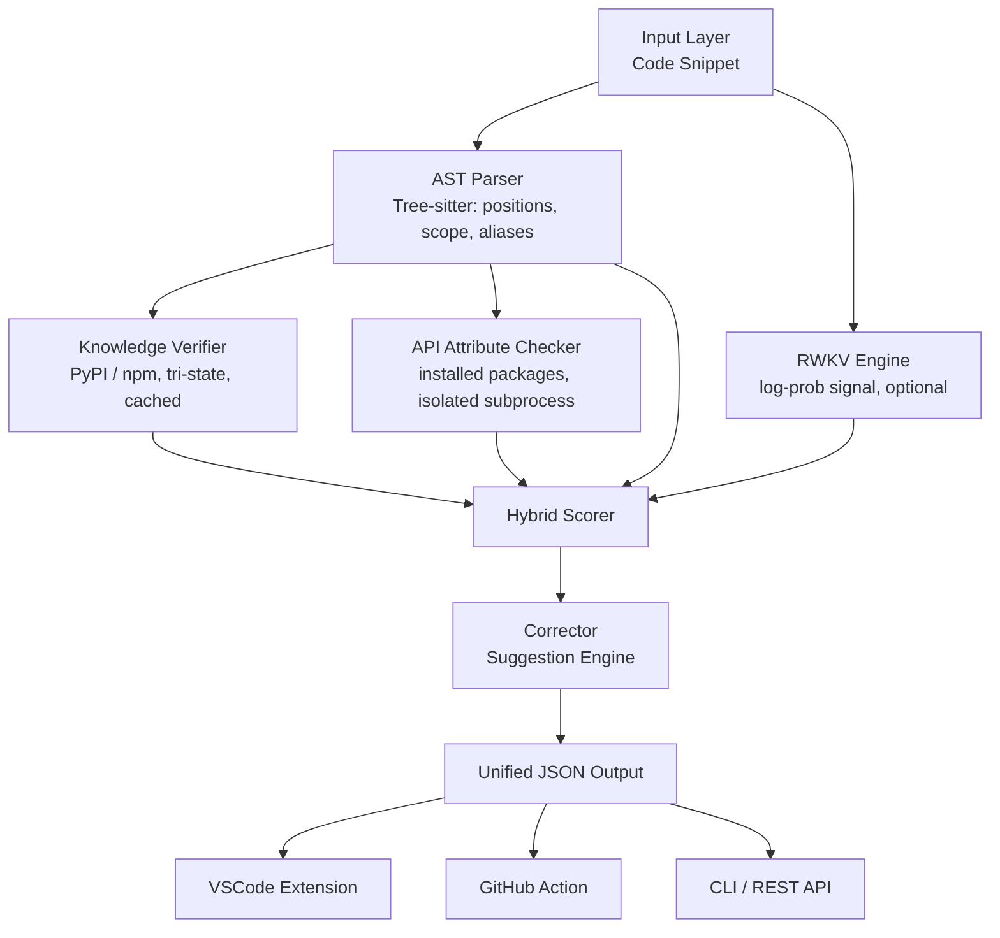

# HalluGuard AI Architecture

## Overview

HalluGuard AI is an open-source AI reliability layer designed to detect, explain, and correct hallucinations in AI-generated code. The system architecture is built around a hybrid approach combining static analysis (AST parsing), external knowledge verification, and local inference models (RWKV).

## System Flow



## Modules and Interfaces

### 1. AST Parser (`core.parser`)
Extracts imports, function calls, and method parameters from Python and JS/TS code using Tree-sitter. 
**Output:** Dictionary of imports, mapped functions, and raw tokens.

### 2. Knowledge Verifier (`core.verifier`)
Decides whether each import is real: standard library, project-local module, curated
import→distribution map (`cv2`→`opencv-python`), module installed in the environment, then
the PyPI / npm registries (parallel, retried, cached in memory and on disk, offline mode).
`exists` is tri-state: `True`, `False`, or `None` (undetermined: network failure / offline),
and an undetermined import is never reported.
`core.verifier.api_checker` additionally resolves `module.attribute` calls and
`var = Class(...)` instances against the **installed** package, in a `python -I`
subprocess with a timeout.
**Output:** `{"verified_imports": {name: {exists, type, ...}}}`.

### 3. RWKV Engine (`core.rwkv_engine`)
Optional local model. The signal is the mean per-token negative log-likelihood of the code
under the model, mapped to a risk in `[0, 100]` (0 = looks fine) through a calibration file.
Unavailable, failing or uncalibrated => no signal (`None`), and the scorer redistributes its
weight. The router escalates only uncertain scores (35-65) to a cloud second opinion, which is
**not implemented**: nothing is ever sent.
**Output:** risk float or `None`.

### 4. Hallucination Scorer (`core.scorer`)
Each issue is worth points (unknown import 50, unknown attribute 40/20, unknown function 12,
LOW notes 8); a source score is `100 * (1 - exp(-points / scale))`. Sources are blended with
weights knowledge 0.5 / AST 0.3 / RWKV 0.2. `severity` is the severity of the worst issue,
`risk_score` the blended aggregate, `confidence` the share of the file that could be verified.
**Output Universel:**

```json
{
  "file": "example.py",
  "risk_score": 56,
  "risk_level": "HIGH",
  "severity": "HIGH",
  "confidence": "HIGH",
  "hallucinations": [
    {
      "line": 12,
      "column": 4,
      "type": "unknown_attribute",
      "token": "requests.fetch_json",
      "explanation": "'requests.fetch_json' does not exist in the installed package API.",
      "suggestion": "Check the package documentation for the correct API.",
      "severity": "HIGH"
    }
  ],
  "suggestions": [],
  "unverified": [],
  "notes": []
}
```
